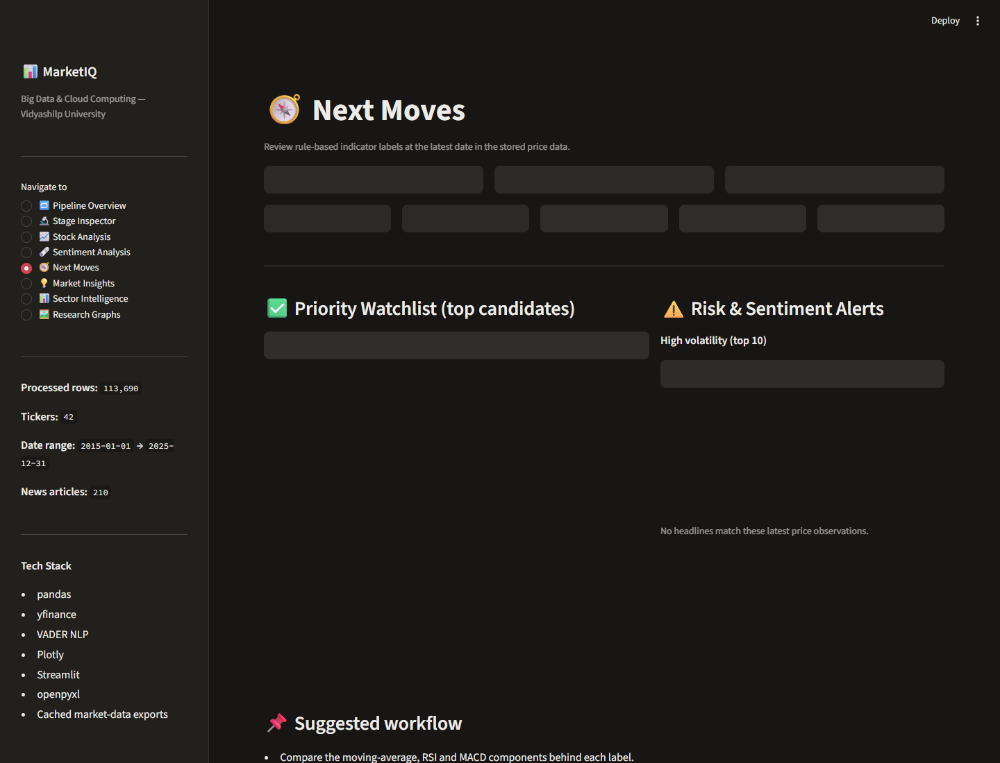

# MarketIQ

MarketIQ is a Python project for exploring historical NSE prices, technical indicators and headline sentiment. It was developed for the Big Data & Cloud Computing course at Vidyashilp University.

The analysis notebook produces the data exports and figures. A Streamlit dashboard adds interactive stock, sector and indicator views.



## Dataset

The included price snapshot contains **113,690 rows, 42 stocks and nine sectors**, covering **1 January 2015 to 31 December 2025**. The processed CSV has 32 columns. Nifty 50 observations are stored separately for the notebook's beta analysis.

The news workbook has **210 scored headlines**, dated **17 October 2025 to 28 April 2026**. Only **29 headlines** match a price row on both date and ticker. It is a small news snapshot, not a complete historical sentiment series. Missing news matches default to zero in the dashboard.

## Dashboard

The eight pages cover:

- Pipeline overview and an inspector for stored data and derived columns.
- Stock prices, moving averages, returns, drawdowns and a rolling Sharpe calculation.
- Headline sentiment, score distributions and matching same-day returns.
- A watchlist combining trend, MACD, RSI, volume and sentiment rules.
- Market summaries, sector comparisons and the eleven saved research figures.

The BUY, HOLD and SELL labels summarize indicator rules. No strategy backtest, portfolio optimizer or order-execution system is implemented. The default view uses stored data rather than live prices.

## Run locally

Python 3.11 or newer is recommended. The cleanup was tested on Windows with Python 3.13.

From the repository root:

```powershell
python -m venv .venv
.venv/Scripts/python.exe -m pip install -r requirements.txt
.venv/Scripts/python.exe -m streamlit run app.py
```

On macOS or Linux, use `.venv/bin/python` in place of `.venv/Scripts/python.exe`. Open the local URL printed by Streamlit, normally http://localhost:8501.

The included files are sufficient to open the dashboard without fetching prices or news. If `data/news_raw.xlsx` is missing, the app attempts to fetch Yahoo Finance headlines and score them with VADER. FinBERT is an optional alternative when its dependencies are installed. Network errors fall back to an empty news view.

To run from another directory, pass the absolute path to `app.py`; data and figure paths are resolved from the application location.

## Run the notebook

```powershell
.venv/Scripts/python.exe -m pip install -r requirements-notebook.txt
.venv/Scripts/python.exe -m jupyterlab
```

Open [notebooks/market_iq.ipynb](notebooks/market_iq.ipynb) and run the cells in order.

- `REFRESH_DATA = False` uses the saved raw workbooks.
- `REFRESH_DATA = True` downloads a new historical extract through yfinance and replaces the raw workbooks.
- Running the notebook overwrites processed exports and figures. Keep a copy before regenerating results you want to retain.
- `RUN_SPARK_EXAMPLE` enables an optional Spark-session example. It needs a separate PySpark installation and Java. The main calculation chain uses pandas.

The notebook computes returns, log returns, moving averages, volatility, outlier flags, 52-week momentum, beta estimates and correlations. The dashboard separately computes MACD, RSI, a 60-session average, sentiment joins and combined indicator labels.

## Repository layout

```text
app.py                         Streamlit entry point
marketiq/analysis.py            Data normalization and indicator calculations
notebooks/market_iq.ipynb       Analysis and data-export workflow
data/                          Raw workbooks and processed exports
graphs/                        Eleven saved notebook figures
docs/architecture/             Original design diagrams
docs/reports/                  Original mid-review report
docs/screenshots/              Current dashboard screenshots
docs/audit.md                  Findings, changes and validation
scripts/launch_dashboard.py    Local launch; optional Cloudflare tunnel
scripts/validate_notebook.py   Cached notebook check with separate outputs
tests/                         Calculation, dashboard and notebook checks
```

See [data/README.md](data/README.md) for the file inventory and [docs/README.md](docs/README.md) for the supporting material.

The processed CSV and Excel file are retained as deliberate exports of the same analysis. The dashboard reads the CSV; the notebook can regenerate both.

## Checks

```powershell
.venv/Scripts/python.exe -m pip install -r requirements-dev.txt
.venv/Scripts/python.exe -m pytest -q
```

For the full cached notebook check, also install `requirements-notebook.txt` and run:

```powershell
.venv/Scripts/python.exe scripts/validate_notebook.py
```

That command copies the raw inputs into `.local-artifacts/`, blocks Yahoo downloads, executes the calculation cells and compares the regenerated CSV with the stored export. It leaves the canonical data and figures unchanged.

## Method limits

- This is a selected stock universe, not the full NSE or Nifty 50 membership. Price coverage varies by listing history.
- Outlier labels suggest possible explanations; they do not establish the cause of a price move.
- Sector growth compounds average log returns. It is a descriptive comparison rather than a backtested investment portfolio.
- The notebook filters its separate beta table by mean daily return. Beta is not included in the processed CSV.
- Rolling calculations use shorter windows near the start of a series. The Sharpe view assumes a zero risk-free rate and 252 sessions per year.
- Cached sentiment scores match VADER, but the news file has no source URLs or collection log. Source labels are retained as supplied.
- The original report and architecture images describe proposed Spark/cloud components. The repository contains no deployed Dataproc, Hadoop, cloud-storage or SQLite integration.
- No project-wide license is supplied. The repository includes third-party price data and headline text.

The [audit](docs/audit.md) records the implementation and data issues found during cleanup.
